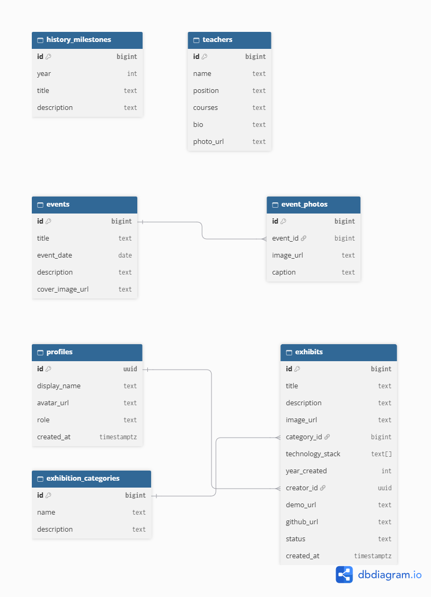

# ISM Дижитал музей

**ISM Дижитал музей** нь Мэдээллийн Системийн Менежментийн тэнхимийн түүх, багш нарын танилцуулга, тэнхимийн өдөрлөг болон арга хэмжээний гэрэл зураг, оюутнуудын бүтээл, судалгаа, технологийн төслүүдийг нэг дор хадгалж, интерактив хэлбэрээр танилцуулах веб аппликейшн юм.

- **Вэб сайт (Vercel):** https://ism-digital-museum-9vas.vercel.app
- **GitHub:** https://github.com/b20fa1759-glitch/ism-digital-museum

## Зорилго

Тэнхимийн түүх, багш нар, оюутнуудын бүтээлийг цахим хэлбэрээр хадгалж, оюутан, багш, зочид хэн ч хялбархан хайж, үзэж, шинэ бүтээл нэмж болдог дижитал музей бий болгох.

## Хэрэглэгчийн эрх

| Эрх | Боломж |
|---|---|
| **Зочин (Guest)** | Бүх хуудсыг үзэх, үзмэрийг нэр, ангилал, он, технологиор хайх |
| **Оюутан (Student / Creator)** | Бүртгүүлэх, нэвтрэх, өөрийн үзмэр нэмэх, засах, устгах, зураг хуулах |
| **Админ (Admin)** | Бүх үзмэрийг удирдах, мөн багш, арга хэмжээ, фото албум, ангилал, түүхийг нэмэх, засах, устгах |

## Үндсэн боломжууд

- **Үзмэрүүд:** жагсаалт, дэлгэрэнгүй хуудас, нэр / он / ангилал / технологиор хайх, шүүх
- **Багш нар:** цол зэрэг, алба нэгж, и-мэйл, өрөөний дугаар, заадаг хичээлүүд
- **Арга хэмжээ:** тэнхимийн өдөрлөг, арга хэмжээ тус бүрийн фото албум
- **Түүх:** тэнхимийн түүхэн үйл явдлууд (эх сурвалжийн холбоостой)
- **ISM Бүтээгчид:** оюутнууд болон тэдний нийтэлсэн бүтээлүүд
- **Бүртгэл, нэвтрэлт, гарах** (Supabase Auth)
- **CRUD ба зураг хуулах** (Supabase Storage)
- **Бүтээлч боломж: ISM Цаг хугацааны машин** — түүхэн үйл явдал, арга хэмжээ, оюутны үзмэрүүдийг нэг цагийн шугам дээр нэгтгэж, төрлөөр нь шүүж, он сонгон аялах боломжтой

## Ашигласан технологи

- **Frontend:** React (JavaScript), Vite, React Router
- **Backend / өгөгдлийн сан:** Supabase (Auth, PostgreSQL, Storage, Row Level Security)
- **Хувилбарын хяналт:** Git, GitHub
- **Байршуулалт:** Vercel

## Суулгах заавар

1. Репозиторийг татах:
   ```bash
   git clone https://github.com/b20fa1759-glitch/ism-digital-museum.git
   cd ism-digital-museum
   ```
2. Сангуудыг суулгах:
   ```bash
   npm install
   ```
3. Төслийн үндэс хавтсанд `.env` файл үүсгэж Supabase-ийн мэдээллээ оруулах:
   ```env
   VITE_SUPABASE_URL=https://<таны-project>.supabase.co
   VITE_SUPABASE_ANON_KEY=<таны publishable key>
   ```
   > `.env` файл `.gitignore`-д орсон тул GitHub руу орохгүй.
4. Supabase дээр хүснэгтүүд, RLS бодлого, Storage bucket-уудыг (`exhibit-images`, `site-images`) үүсгэх. Доорх "Өгөгдлийн сан" хэсгийг үзнэ үү.
5. Ажиллуулах:
   ```bash
   npm run dev
   ```
   Хөтчөөр `http://localhost:5173` хаягийг нээнэ.
6. Админ эрх олгох (Supabase SQL Editor):
   ```sql
   update profiles set role = 'admin'
   where id = (select id from auth.users where email = 'таны@имэйл');
   ```

## Өгөгдлийн сан



### Хүснэгтүүд, primary key ба foreign key

| Хүснэгт | Үндсэн баганууд | Primary key | Foreign key |
|---|---|---|---|
| `profiles` | id, display_name, avatar_url, role | `id` (`auth.users.id`-тэй адил) | `id` → `auth.users.id` |
| `exhibition_categories` | id, name | `id` | — |
| `exhibits` | id, title, description, category_id, technology_stack, year_created, demo_url, github_url, status, image_url, creator_id, created_at | `id` | `category_id` → `exhibition_categories.id`, `creator_id` → `profiles.id` |
| `teachers` | id, name, position, department, degree, email, office, courses, bio, photo_url | `id` | — |
| `events` | id, title, event_date, description, cover_image_url | `id` | — |
| `event_photos` | id, event_id, image_url, caption | `id` | `event_id` → `events.id` (арга хэмжээг устгахад зургууд нь хамт устна) |
| `history_milestones` | id, year, title, description | `id` | — |

Үзмэр бүр нэг бүтээгч (`profiles`) болон нэг ангилалд хамаарна. Арга хэмжээ бүр олон зурагтай байж болно (1 ба олон холбоо).

## Аюулгүй байдал (RLS)

Бүх хүснэгт дээр Row Level Security идэвхтэй.

- Нийтлэгдсэн мэдээллийг хэн ч унших боломжтой.
- Оюутан үзмэр нэмж, зөвхөн **өөрийн** үзмэрийг (`creator_id = auth.uid()`) засаж, устгана.
- Админ (`profiles.role = 'admin'`) багш, арга хэмжээ, фото албум, ангилал, түүхийг удирдана. Эрхийн шалгалтыг `public.is_admin()` функц гүйцэтгэнэ.
- Storage бодлого: оюутан зөвхөн өөрийн хавтас руу зураг хуулна, админ бүх хавтсанд хуулна.
- Frontend-д зөвхөн нийтийн (anon / publishable) түлхүүр ашигласан бөгөөд нууц (service) түлхүүр ашиглаагүй.

## Wireframe ба дэлгэцийн зураг

`docs/wireframes/` хавтсанд үндсэн хуудсуудын зураг байна:

| Хуудас | Файл |
|---|---|
| Нүүр хуудас | `docs/wireframes/home.png` |
| Үзмэрүүд | `docs/wireframes/exhibits.png` |
| Үзмэрийн дэлгэрэнгүй | `docs/wireframes/exhibitsdetails.png` |
| Багш нар | `docs/wireframes/teachers.png` |
| Арга хэмжээ | `docs/wireframes/events.png` |
| Цаг хугацааны машин | `docs/wireframes/timemachine.png` |

## Эх сурвалж

Түүхэн мэдээлэл: [СЭЗИС-ийн албан ёсны түүх](https://ufe.edu.mn/en/c/28), [Wikipedia: University of Finance and Economics (Mongolia)](https://en.wikipedia.org/wiki/University_of_Finance_and_Economics_(Mongolia)). Тэнхимийн багш нарын мэдээлэл СЭЗИС-ийн албан ёсны вэб сайтаас авсан. Зарим үзмэр, арга хэмжээ, түүхэн мэдээлэл нь жишээ (туршилтын) өгөгдөл болно.
